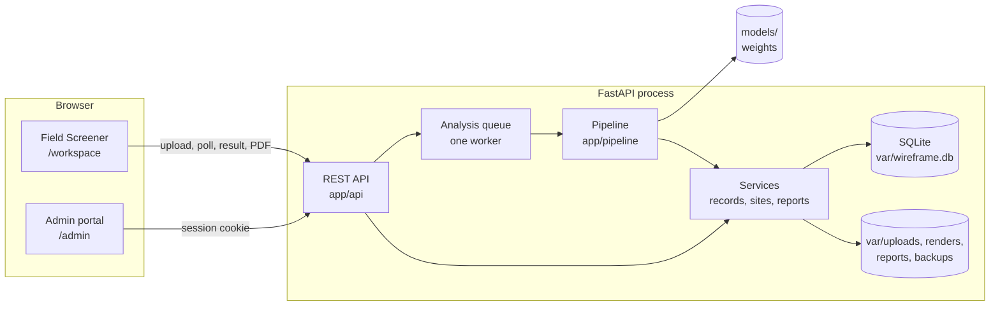
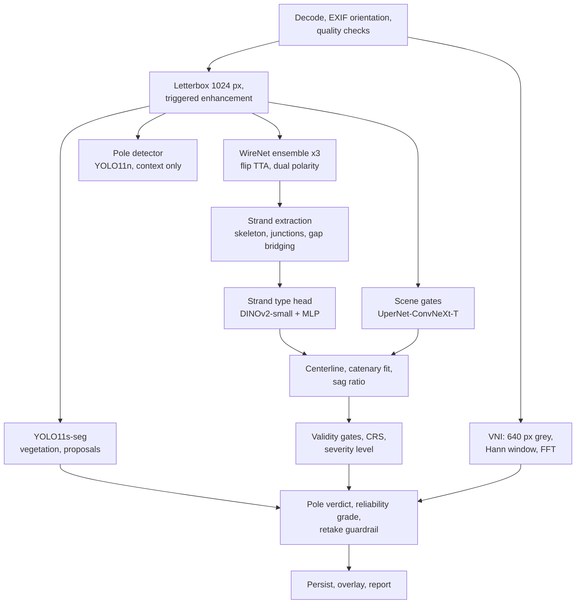

# WIREFRAME Thesis Reference

Technical reference for the WIREFRAME thesis manuscript. It describes the system as released (v2.23, 18 Nov 2026):
what it computes, how, with which models and data, how well it performs, and what it cannot do. Every number is
taken from a file in `docs/thesis/results/` or from the code and configuration in this repository; the source is
named next to the number.

Contents

1. Overview
2. System architecture
3. Technology stack and versions
4. Dataset
5. Models
6. Wire reconstruction pipeline
7. Geometry and sag equations
8. Assessment rules
9. Backend, database and API
10. User interface
11. Reports
12. Algorithmic complexity
13. Runtime performance
14. Evaluation
15. Testing
16. Security and data handling
17. Limitations
18. Reproducibility
19. References
20. Appendix: endpoint, schema and configuration inventory

---

## 1. Overview

WIREFRAME is a web application for screening overhead telecommunication and distribution wires from one
ground-level photograph of a utility pole. For each photo it:

1. finds the overhead wires at pixel level and separates them into individual strands;
2. classifies each strand as a power distribution line, a telecom cable (including fiber drops) or an abandoned wire;
3. fits a catenary to each strand's centerline and measures its sag ratio (sag / chord length);
4. assesses the sag against a configured reference, but only where the measurement is valid (both span endpoints
   visible, a confident wire type, a class with a configured reference);
5. checks vegetation contact and the photo's reliability;
6. returns a pole-level verdict, a plain-language result page and a PDF report, and stores the inspection for
   staff (dashboard, records, map and dispatch routes).

**Scope.** WIREFRAME is a screening aid. It does not certify that a span is safe, does not measure sag in metres,
and its sag reference values are development placeholders until calibrated with a licensed engineer
(Section 17). Every result page and report states that field verification by qualified personnel is required.

**Deployment target.** A desktop or laptop browser (window width at least 1024 px); there is no mobile application.
The server runs on one machine (developed and measured on an Apple M1 with 8 GB of unified memory).

**Users.**

| Role | Access |
|---|---|
| Field user (no account) | Field Screener: upload a photo, read the result, download the PDF for that inspection |
| Inspector (account) | Admin portal: Dashboard, Inspections, inspection pages, Map & Dispatch, reviews, exports, assistant |
| Administrator (account) | Everything an inspector can do, plus test-record management, location editing, technical exports, model and settings API |

---

## 2. System architecture



**Request path of one inspection.** `POST /api/analysis/upload` validates the file, strips GPS, stores the image
under a random name, creates the `analyses` row with status `queued` and enqueues it (`app/services/queue.py`). One
worker thread runs the pipeline (`app/pipeline/runner.py: run_analysis`) and persists detections, flags and timings
(`app/services/analysis.py`). The browser polls `GET /api/analysis/{id}` and then reads
`GET /api/analysis/{id}/result`. PDFs are built on request (`app/services/report_pdf.py`).

**Pipeline stages** (`run_analysis`; timings are stored per stage in `timings_json`):



**Code layout.**

| Path | Contents |
|---|---|
| `app/main.py` | Application factory, static pages, health and config endpoints, security headers |
| `app/api/` | Routers: `analysis`, `reports`, `auth`, `admin`, `dashboard`, `assistant` |
| `app/pipeline/` | Image processing, models, geometry and assessment (no web or database code) |
| `app/services/` | Persistence, queue, records, sites and priority, PDFs, plain-language text, barangay and coordinate validation |
| `app/models/` | SQLAlchemy ORM and database setup |
| `app/core/` | Settings, analysis configuration, security, state, model-weight provisioning |
| `app/assistant/` | Documentation assistant (intent routing, live answers, optional Claude provider) |
| `app/web/` | HTML pages, ES-module JavaScript and CSS (no build step) |
| `config/wireframe.yaml` | Every analysis parameter (Section 20.3) |
| `ml/` | Training, evaluation, benchmark, dataset curation, research experiments |
| `scripts/` | Administration and verification tools |
| `tests/` | pytest suite |

---

## 3. Technology stack and versions

Versions installed in the measurement environment (`.venv`, 18 Nov 2026). Minimum versions are declared in
`requirements.txt` (runtime), `requirements-dev.txt` (tests and lint) and `requirements-ml.txt` (training).

| Component | Version | Role |
|---|---|---|
| Python | 3.13.2 | Runtime (3.11 or later supported) |
| FastAPI | 0.162.4 | HTTP API |
| Uvicorn | standard extras | ASGI server |
| Pydantic, pydantic-settings | 2.x | Request validation, settings |
| SQLAlchemy | 2.1.8 | ORM over SQLite |
| NumPy | 2.5.4 | Array computation |
| SciPy | 1.x | Levenberg-Marquardt fit, Brent root finding |
| OpenCV (headless) | 5.0.0 | Image processing, distance transform, connected components |
| scikit-image | 0.26.0 | Zhang-Suen skeletonisation (OpenCV contrib `ximgproc` is used instead when installed) |
| PyTorch | 2.15.0 (MPS backend) | Neural network inference |
| segmentation-models-pytorch | 0.6.0 | WireNet U-Nets |
| Ultralytics | 8.4.210 | YOLO11 segmentation and detection |
| transformers | 4.57.6 | DINOv2-small, UperNet-ConvNeXt-T |
| ReportLab | 5.1.0 | PDF reports |
| Pillow | 11 or later | Image I/O, badge rendering |
| Leaflet, Leaflet.markercluster | browser libraries | Map and clustering |
| pytest, ruff, pypdfium2, Playwright | development | Tests, lint, PDF text checks, browser checks |
| Hardware | Apple M1, 8 GB unified memory | Development and all measurements |
| Operating system | macOS 26.0.1 | |

Base maps: OpenStreetMap standard tiles (Light), Esri World Dark Gray Base with reference labels (Dark), Esri World
Imagery (Satellite); none needs an API key. If a tile provider fails, the map falls back to OpenStreetMap.

---

## 4. Dataset

### 4.1 Wire dataset

| Item | Value |
|---|---|
| Source | Team-labelled export "Wireframes-Prelabelled-Datasets" (Roboflow), export of 14 Nov 2026, no pre-processing |
| Licence | CC BY 4.0 |
| Photos | 145 ground-level photos of utility poles |
| Split | train 102 / validation 22 / test 21, balanced by wire-density tertile |
| Classes | `Vegetation`, `abandoned-wire`, `power-distribution-lines`, `telecom-cable` (fiber drops are labelled telecom) |
| Labels | Polygon masks at span level |
| Preparation | Letterboxed to 1024 x 1024 with grey (114) padding, the same as at inference (`ml/curate.py`) |

Curation audit (`results/dataset_audit_v27.json`): 0 excluded for viewpoint, 0 duplicates, 0 corrupt label lines,
0 unmapped labels; 145 distinct native sizes, aspect ratios 0.76 to 3.87.

| Class | Instances | Fragment share | Median width at 1024 px |
|---|---|---|---|
| Vegetation | 220 | n/a | 7.1 px |
| abandoned-wire | 27 | 70 % | 8.7 px |
| power-distribution-lines | 1,801 | 11.5 % | 2.1 px |
| telecom-cable | 2,441 | 10.6 % | 2.1 px |

Test split labelled instances: power 253, telecom 361, abandoned 7, vegetation 38.

**Use of the splits.** Training used only the train split. All model and threshold selection used the validation
split. The test split was evaluated after the configuration was frozen; the released configuration was scored on
test once more as a reproduction check (Section 14).

**Known label gaps.** Dense bundles and low isolated wires are often unlabelled, so measured precision is a lower
bound (Section 14.1).

### 4.2 Pole dataset (detector only)

No WIREFRAME photo has pole labels. The pole detector was trained and evaluated on public data
(`ml/poles/lvis_prepare.py`, `ml/poles/build_v218.py`): LVIS v1 `telephone_pole` boxes (CC BY 4.0 annotations on COCO
images, which stay local under their Flickr licences) plus 283 LVIS images verified to contain no telephone pole
(43 of them with confusable structures such as lamp posts and masts). Train 938 images (2,412 boxes), validation 166
(408), test 197 (516). The detector was initialised from a YOLO11n trained on the Street View pole set of Zenodo
record 20091961 (CC BY 4.0).

### 4.3 Location reference data

`app/data/barangays_cavite.json`: 829 barangays of Cavite province from the Philippine Standard Geographic Code
(PSGC), used to validate and normalise the barangay of every pole (`app/services/barangay.py`).

### 4.4 Privacy

GPS metadata is removed from every stored photo at the JPEG segment level, so the analysed pixels are exactly the
uploaded pixels. Coordinates are stored only when a user enters them, in a separate table (`pole_locations`), and are
visible only to signed-in staff. The dataset curation tool screens for faces and licence plates and fails closed
(every image is listed for manual review when no detector is available).

---

## 5. Models

The model set is frozen. No model was trained or changed for this release.

### 5.1 Models loaded by the released configuration

| Model | File | Parameters | Input | Role |
|---|---|---|---|---|
| WireNet-R34: U-Net, ResNet-34 encoder, 5 classes | `models/wirenet-r34.pt` | 24.4 M | 1024 x 1024 | Ensemble member |
| WireNet-MiT-B1: U-Net, Mix Transformer B1 encoder | `models/v212_mitb1.pt` | 16.4 M | 1024 x 1024 | Ensemble member |
| WireNet-ConvNeXt-T: U-Net, ConvNeXt-Tiny encoder | `models/v212_convnext_t.pt` | 31.9 M | 1024 x 1024 | Ensemble member |
| Ensemble recipe (equal weights) | `models/v217_ensemble.json` | n/a | n/a | Probability fusion of the three members |
| YOLO11s-seg, fine-tuned (file name kept for compatibility) | `models/wireframe-yolo11m-seg.pt` | 10.1 M | 1024 | Vegetation masks and wire proposals |
| YOLO11n pole detector, fine-tuned | `models/poles-yolo11n-v218.pt` | 2.6 M | 640 | Pole boxes, context only |
| DINOv2-small (frozen) | `models/hf/dinov2-small` | 22.1 M | 1008 x 1008 (72 x 72 patches) | Features for the strand type head |
| Strand type head: 2-layer MLP | `models/strand_head_v217.pt` (+ `.json` statistics) | 56 -> 32 -> 1 | 24 hand features + 32 PCA dimensions of DINOv2 | Power vs telecom per strand |
| UperNet-ConvNeXt-T, ADE20K (not trained by the team) | `models/hf/upernet-convnext-tiny` | 60.2 M | 384 px | Scene gates (ground, structure edges, vegetation check) |

Parameter counts were computed from the loaded weights. The WireNet output classes are background, abandoned-wire,
power-distribution-lines, telecom-cable and vegetation.

### 5.2 Training (historical record, not repeated)

| Model | Recipe |
|---|---|
| WireNet members | 102 training photos at 1024 letterbox, 512 x 512 random crops (80 % centred on a wire); loss = class-weighted cross-entropy + soft Dice + clDice; AdamW with a one-cycle schedule; blur and contrast augmentations (Albumentations); no vertical flip or rotation (an inverted catenary is an arch). R34: 40 epochs, best 29, 2.63 h on MPS. MiT-B1: 40 epochs, best 32, 4.66 h. ConvNeXt-T: 20 epochs, best 16, 3.39 h |
| YOLO11s-seg | 1024 px, batch 1 with gradient accumulation to 64, best at epoch 22; YOLO11m-seg ran out of memory on the 8 GB M1 |
| Strand type head | Stacked on validation strands plus train strands (the members' output on their own training photos is unrealistically clean); a strand is a training case only when 50 % or more of its skeleton lies on a labelled power or telecom wire; validation figures for the head are leave-one-photo-out |
| Pole detector | YOLO11n from the Street View checkpoint, 50 epochs, rotation augmentation of 5 degrees; threshold 0.25 chosen on validation |

Abandoned wire cannot be learned from 27 instances: every attempt (oversampling, copy-paste, focal loss, logit
adjustment) raised recall only by labelling ordinary wires as abandoned (precision at most 0.04).

### 5.3 Model provisioning

Weights are not in the code history. They are published on the repository's `model-weights` branch;
`app/core/weights.py` downloads any missing file in a background thread on first start, checks size and SHA-256,
joins files published in parts, installs atomically and never overwrites an existing file.
`WIREFRAME_AUTO_DOWNLOAD=0` disables downloads. Until the weights are present the screener runs in validation mode,
and an upload without reference polygons is refused with HTTP 503 before anything is stored: there is no mock
detector.

---

## 6. Wire reconstruction pipeline

### 6.1 Ingestion and pre-processing (`app/pipeline/preprocess.py`, `enhance.py`)

- Every readable image is converted to 8-bit RGB (EXIF orientation applied; 16-bit, alpha, CMYK, palette and grey
  images converted) and capped at 2048 px on the long side. Upload limit 64 MB (`WIREFRAME_MAX_UPLOAD_MB`).
- Photos under 320 px on the short side, or blank, are accepted but graded Retake.
- Segmentation input: letterbox to 1024 px with fill 114. Enhancement runs only when its trigger fires: bilateral
  denoise for Immerkaer noise sigma >= 3 or JPEG blockiness >= 1.3; CLAHE on L* for low contrast (std of L <= 12)
  or overexposure (share of L > 97 at least 0.25), never for darkness; blur-adaptive unsharp mask for Laplacian
  variance <= 60.
- VNI input: a separate 640 px grey path with a fixed 5 x 5 Gaussian, never enhanced, so VNI stays comparable.

### 6.2 Segmentation (`app/pipeline/wirenet.py`, `segment.py`)

- **WireNet ensemble.** The three members run one at a time on the photo and on its mirror image; the six softmax
  maps are averaged (`_probs_lowmem`). This is arithmetically the fused module and keeps peak GPU memory near one
  member's (Section 13.4).
- **Dual polarity.** For a photo with mean L* <= 40 the ensemble also runs on the photo with L* inverted (chroma
  kept); the inverted result is used when it finds at least 1.2 times the wire pixels. Flag `polarity_inverted`.
- **Wire mask.** A pixel is wire when P(any wire class) >= 0.4 (`span_wire_tau`), not only when a wire class wins
  the argmax; this keeps faint cables whose probability is split between power and telecom.
- **YOLO11s-seg** supplies vegetation masks (confidence >= 0.20, NMS IoU 0.45) and coarse proposals.
- **Pole detector** supplies pole boxes (confidence >= 0.25) for display and endpoint context. It never creates or
  joins a wire (`pole_occluder_gap: 0`).

### 6.3 Strand extraction (`app/pipeline/wire_instances.py`)

Spans are built once on the union of the wire classes, so each physical strand has one class:

1. Wire mask components under 30 px are removed; the mask is skeletonised (Zhang-Suen).
2. Junction pixels (3 or more skeleton neighbours) are removed; junction points within 5 px count as one crossing.
3. Pieces meeting at a crossing are re-joined when their end directions agree within 35 degrees, straightest pair
   first. Pieces shorter than 15 px are dropped before joining.
4. **Gap bridging.** Two span ends a and b are joined when |b - a| <= 70 px, the end tangents are opposed within 35
   degrees, the gap continues both tangents within 35 degrees, and the lateral offset is at most 15 px. Tangents come
   from the 12 skeleton points nearest each end. Candidate pairs are evaluated vectorised and accepted nearest first
   with union-find, each end used once. The bridge is drawn 2 px wide so the fit runs through it.
5. Stitched spans shorter than 90 px are dropped.
6. **Pixel ownership.** Each mask pixel is assigned, by Euclidean distance transform, to the nearest span within its
   own connected mask blob, so a neighbouring cable is not painted into a span.
7. **Provenance.** Pixels added by bridging were never labelled wire by the model. The API reports observed and
   inferred pixels per span, and the viewer draws inferred gaps dashed ("Estimated, not detected"). The bridge stays
   in the measurement.

### 6.4 Strand type (`app/pipeline/strand_head.py`)

For each strand the head reads 24 hand-crafted features (summed fused class evidence, mean P(wire) and entropy,
length, straightness, sag ratio, orientation, width, height in the photo, share of strands above it, darkness against
a local ring, colour, local texture) and DINOv2-small patch features pooled along the skeleton and projected to 32 PCA
dimensions. Features are standardised with the stored training statistics and passed to a 2-layer MLP
(56 -> 32 -> 1) that outputs P(telecom). The abstention threshold is 0.5, so every power or telecom strand receives a
type. Strands whose evidence is mostly abandoned-wire keep the pixel rule and are typed "uncertain" when the top
class holds under 90 % of the evidence. The head never removes a strand.

### 6.5 Scene gates (`app/pipeline/scene.py`)

UperNet-ConvNeXt-T parses the scene at 384 px (ADE20K classes). The gates fail open, with a flag, if the parser cannot
load.

| Gate | Rule | Effect |
|---|---|---|
| Ground | 50 % or more of a span's pixels on road, sidewalk, floor, earth, path, grass, field, sand, dirt track, runway or rug | Span listed as suppressed ("Lies on the road or pavement"), never scored |
| Structure edge | Different ADE20K classes on the two sides of a span along 60 % or more of its length | Span listed as suppressed (outline of a flyover, canopy or sign) |
| Vegetation check | A YOLO vegetation region with under 40 % of its area on tree, grass, plant or palm | Region suppressed (no vegetation contact from it) |

### 6.6 Centerline

Each kept strand's mask is thinned again (vectorised Zhang-Suen) and turned into an 8-connected pixel graph; spurs
shorter than 30 px are pruned iteratively and the longest path is found by double breadth-first search. With fewer
than 20 points the status is `too_short`. The catenary fit and sag are defined in Section 7.

### 6.7 Vegetation Noise Index (`app/pipeline/vni.py`)

The 640 px grey image, mean removed, is multiplied by a periodic Hann window and transformed by a 2-D FFT. VNI_raw is
the share of spectral power beyond r_L = 0.15 * min(M, N) / 2; it is scaled between the training quantiles
q01 = 0.034 and q99 = 0.243 and clipped to [0, 1]. Bands: Low <= 0.25, Moderate <= 0.50, High <= 0.75, Severe <= 1.00.
VNI feeds the multi-pole priority index (Section 7.6); it does not change any wire's assessment.

---

## 7. Geometry and sag equations

Coordinates are image pixels with the y axis pointing up (the fit flips image rows), so a sagging wire is convex.

### 7.1 Catenary model

    y(x) = a * cosh((x - b) / a) + c,        a > 0

Starting values come from a parabola fitted to the centerline. The parameters are estimated by Levenberg-Marquardt
(`scipy.optimize.curve_fit(method="lm")`) with an analytic Jacobian, in coordinates normalised by the chord length:

    u = (x - b) / a
    dy/da = cosh(u) - u * sinh(u),    dy/db = -sinh(u),    dy/dc = 1

The fit fails (status `fit_failed`, reason `no_convergence`, `non_positive_a`, `residual_too_large` or `degenerate`)
on non-convergence within 4,000 function evaluations, a <= 0, a degenerate centerline, or a relative RMS residual
above 0.02:

    rel_residual = sqrt(mean((y_i - y(x_i))^2)) / L  >  0.02

### 7.2 Chord, sag and sag ratio

The chord joins the fitted curve's values at the two end abscissas x_0 and x_1:

    L = sqrt((x_1 - x_0)^2 + (y(x_1) - y(x_0))^2),     m = (y(x_1) - y(x_0)) / (x_1 - x_0)

The sag delta is the largest perpendicular distance from the chord to the curve. Setting the curve's slope equal to the
chord's slope gives the point of maximum sag in closed form:

    sinh((x* - b) / a) = m    =>    x* = b + a * asinh(m)

    delta = |y_chord(x*) - y(x*)| / sqrt(1 + m^2)

    sag ratio:  delta_rel = delta / L

If x* falls outside [x_0, x_1] there is no interior maximum and the sag is 0.

### 7.3 Truncation and endpoints

An endpoint within 1 % of the image side from the border marks the fit as truncated: the span leaves the photo, so its
chord is not the pole-to-pole chord (Section 8.1).

### 7.4 Measurement-precision gate

With 1 px of skeleton noise (sigma) and the requirement that noise move delta/L by at most a quarter of the reference
ratio:

    sigma / L <= f * delta_lim    =>    L_min = 1 / (0.25 * 0.040) = 100 px

Shorter chords get status `too_short` (`chord_below_precision_gate`). The gate scales with the photo's resolution
relative to the 1024 px model input. The value was derived from precision, not tuned.

### 7.5 Reference sag and Catenary Risk Score

The allowable sag ratio delta_lim starts from the reference value delta_lim,0 = 0.040 for every class. When span
length, temperature or wind are supplied, a change-of-state relation with wind load (1/2 * rho * V^2 * C_d * d),
solved with Brent's method, adjusts it; otherwise delta_lim = delta_lim,0 with flag `default_parameters`. All
conductor values are illustrative placeholders (flag `development_limits`).

    CRS = min(10, 10 * (delta_rel / delta_lim) * w_class),     w_class = 1 for every class

With delta_lim = 0.040 and w = 1 the severity levels correspond to sag ratios:

| Level (stored) | Shown as | CRS | Sag ratio |
|---|---|---|---|
| low | Within reference | CRS < 6.0 | delta/L < 2.4 % |
| medium | Minor sag | 6.0 <= CRS < 10.0 | 2.4 % <= delta/L < 4.0 % |
| high | Critical | CRS >= 10.0 | delta/L >= 4.0 % |
| (none) | Not assessed | no CRS | any |

Lower bounds are inclusive (`crs.levels.minor_from: 6.0`, `critical_from: 10.0`). CRS is compared after rounding to 9
decimals, so a sag of exactly 2.4 % lies on its boundary as configured. Tests cover each boundary value
(`tests/test_v221.py`).

### 7.6 Multi-pole priority index

    MSPI = alpha * VNI + beta * mean(CRS) / 10 + gamma * max(CRS) / 10,     alpha + beta + gamma = 1

Default weights are 1/3 each. Rankings use the latest operational inspection of each pole. A 66-point weight grid
(step 0.1) gives the Spearman rank correlation of each weighting with the baseline ranking; it is printed in the
technical priority report.

### 7.7 Vegetation clearance

Vegetation masks are never skeletonised or scored. A wire is in contact when at least 2 % of its pixels lie within 1 %
of the longer image side of a vegetation mask. Clearance in pixels comes from the distance transform of the vegetation
union; metre values are labelled approximate (scale from the median power-wire width and a 10.1 mm conductor
diameter).

---

## 8. Assessment rules

### 8.1 Per-wire decision table (`app/pipeline/runner.py: _score_wire`)

The checks run in this order; the first that applies decides the status.

| # | Condition | Status | Reason code | Severity |
|---|---|---|---|---|
| 1 | Centerline has fewer than 20 points | `too_short` | `too_short` | none |
| 2 | Catenary fit fails | `fit_failed` | `no_convergence`, `non_positive_a`, `residual_too_large`, `degenerate` | none |
| 3 | Chord below the precision gate (100 px at 1024) | `too_short` | `chord_below_precision_gate` | none |
| 4 | An endpoint is at the photo border | `not_assessed` | `endpoint_unavailable` | none (the visible sag is kept as `unverified_level`, a review cue) |
| 5 | Strand type uncertain | `not_assessed` | `class_uncertain` | none |
| 6 | Class has no configured reference (power distribution lines) | `not_assessed` | `no_reference_for_class` | none |
| 7 | Otherwise | `scored` | none | CRS and level (Section 7.5) |

`crs.assessed_classes: [telecom-cable, abandoned-wire]`: the 4.0 % telecom reference is never applied to power
distribution lines; they are measured and shown, but not assessed. A severity label is never shown on a wire that was
not scored; the end-to-end check verifies this on a live server (Section 15.3).

### 8.2 Pole verdict (`app/pipeline/hazard.py`)

| Factor | Rule | Verdict |
|---|---|---|
| Sag | k*(n) or more scored spans at Critical (p0 = 0.050) | AT RISK - HIGH |
| Sag | k*(n) or more scored spans at Minor sag or above (p0 = 0.090) | AT RISK - MODERATE |
| Vegetation | Power span in contact | AT RISK - HIGH |
| Vegetation | Power span within 15 px | AT RISK - MODERATE |
| Vegetation | Telecom span in contact | AT RISK - MODERATE |
| Coverage | Fewer than half of the measured spans assessed (`hazard.min_assessed_share: 0.5`) | INCONCLUSIVE - RETAKE PHOTO instead of NOT AT RISK |
| Partial spans | A span running off the photo whose visible part already sags into a band | INCONCLUSIVE - RETAKE PHOTO instead of NOT AT RISK |
| Reliability | Grade Retake and no hazard found | INCONCLUSIVE - RETAKE PHOTO (a found hazard is kept, with a note) |
| None of the above | | NOT AT RISK |

Corroboration: with n scored spans, a band counts only when the number of spans in it reaches

    k*(n) = min { k : P(Binomial(n, p0) >= k) <= alpha },     alpha = 0.05

p0 is the per-span test-retest disagreement rate measured on validation (each photo analysed as is and mirrored, 492
matched scored spans; `results/v29_span_geometry_summary_all_val.json`). Spans in a band that do not reach k* are
listed as a note to verify visually. The rule is a significance test against measurement noise, not an estimate of
the true hazard rate.

| Scored spans n | 1 | 2 | 5 | 10 | 22 | 30 |
|---|---|---|---|---|---|---|
| k* Critical (p0 0.050) | 1 | 2 | 2 | 3 | 4 | 5 |
| k* Minor or above (p0 0.090) | 2 | 2 | 3 | 4 | 5 | 6 |

### 8.3 Reliability grade (`app/pipeline/quality.py`)

Over predicted wire pixels: U = mean normalised entropy; D = share whose class flips between the plain and mirrored
passes; R = 1 - (U + D) / 2. Grade A if R >= 0.78, B if R >= 0.66, C if R >= 0.64, else Retake. The grade is also
Retake when there are fewer than 500 wire pixels, mean L* < 8, more than 85 % clipped pixels, or when the glare gate
fires (near-white share >= 0.6 and thin-line contrast < 15 L* units). Each grade below A carries a plain cause (blank,
low resolution, glare, too dark, almost no wire, camera shake, out of focus, low light, model uncertainty).

### 8.4 Retake guardrail (`app/pipeline/guardrail.py`)

The guardrail reads the finished analysis and never changes a wire, class, CRS or verdict. It decides whether the
result is held behind "Retake photo / Proceed anyway" from the reliability grade, capture envelope, class conflicts,
uncertain-type share, fragmentation and structure edges (thresholds in `config/wireframe.yaml: guardrail`). The
user's choice is recorded (`POST /api/analysis/{id}/guardrail`) and printed in the PDF.

### 8.5 Human review

A reviewer can confirm a result, flag it for further inspection (note required) or override its level (level and note
required). The computed level is never changed: reviews are stored beside it (`reviews` table), shown on the
inspection page and printed in the PDF, and every review is written to the audit log.

---

## 9. Backend, database and API

### 9.1 Processing

- One asyncio queue with one worker thread (`app/services/queue.py`); the models are loaded once at startup. On
  startup, inspections left in `processing` by a crash or restart are re-queued.
- Failed inspections are never re-run automatically. An inspector re-runs one at a time from the Failed tab
  (`POST /api/analysis/{id}/retry`). Historical inspections are never reprocessed in bulk, so stored model findings
  stay as produced; each analysis stores the configuration fingerprint it was produced with.
- List views load only the detection columns they need (`app/services/records.py: list_columns`), never the stored
  polygons and curves: the inspections list takes 0.05 to 0.2 s on the 98-inspection database instead of 3 to 4 s.

### 9.2 Database

SQLite with foreign keys enforced and CHECK constraints (`app/models/orm.py`). Missing columns are added at startup; a
table-rebuild migration first writes a timestamped backup to `var/backups/`.

| Table | Purpose |
|---|---|
| `poles` | One row per pole code; validated barangay; stored readable label (e.g. SAL-001) |
| `pole_locations` | Optional coordinates (Philippine bounds 4.2 to 21.3 N, 116 to 127 E), source, time |
| `analyses` | One inspection: file names, status, error, VNI, metadata, flags, timings, vegetation, configuration fingerprint, record kind (operational or test) |
| `detections` | One wire: class, confidence, status, reason, geometry (JSON), chord, sag, sag ratio, delta_lim, CRS, level, flags |
| `reviews` | Human decisions stored beside the computed result |
| `reports` | PDF build records (file, SHA-256, configuration fingerprint) |
| `admin_users`, `admin_sessions` | Accounts (scrypt hashes, role) and sessions (SHA-256 of the token only) |
| `audit_events` | Who changed what and when |
| `app_settings` | Administrator settings (active model, priority weights) |

Audited actions: reviews, record-kind changes, location and barangay edits, retries, deletions, model activation and
settings changes.

**Test records.** QA, synthetic, timing and check uploads are kept but marked `record_kind = test`; they never count
in the dashboard, lists, map or exports. Administrators can view them (`include_test=true`) and re-classify a record
by hand; nothing is deleted.

### 9.3 API summary

37 operations (full list in Section 20.1). Access levels: public, inspector session, administrator session.

| Group | Endpoints |
|---|---|
| Field Screener (public) | upload, status, result, image, wire mask PNG, guardrail choice, PDF report |
| Health and configuration (public) | `/api/health`, `/api/config` |
| Authentication | login, logout, current user |
| Portal (inspector) | dashboard, inspections list, bulk actions, inspection context, findings CSV, reviews, barangay search and assignment, audit log, priority ranking, site and route PDFs, inspections CSV, retry, delete, assistant |
| Administration (administrator) | record kind, pole location, queue, models and activation, settings, system status, manifest and per-wire CSV exports |

Errors use one envelope: `{"error": {"code", "message", "hint"}}`.

---

## 10. User interface

Plain HTML, CSS and ES-module JavaScript served by the API (no build step), with light and dark themes.

### 10.1 Field Screener (`/workspace`, public)

- Upload card: photo, inspection name, city, barangay (validated suggestions), optional coordinates and span data.
- Processing state with the queue position.
- Result page (`/workspace/result/{id}`): inspection summary with the counts of Critical, Minor sag, Within reference
  and Not assessed wires; the photo with three views (Wires, Mask, Photo); circular wire badges centred on each
  strand; the wire list with plain findings and the reason for every unassessed wire; what to do next; photo
  limitations; a location block when coordinates exist; PDF download.
- A retake prompt when the guardrail holds the result.

### 10.2 Admin portal (`/admin`, signed in)

| Page | Functions |
|---|---|
| Dashboard | Counts by pole verdict over the latest operational inspection per pole; triage list; pending reviews; alerts |
| Inspections | Filters (search, risk, review, barangay, date range, completeness, latest only), tabs (All, Needs review, Failed), bulk actions, CSV export, technical exports menu (administrators) |
| Inspection page | Result viewer, findings table, review panel, pole history, findings CSV, technical diagnostics (collapsed) |
| Map & Dispatch | Leaflet map with clustered pole markers coloured by verdict; Light, Dark and Satellite base maps; drop-pin location editing (administrators); route builder with ordered stops, route PDF and a shareable map link |
| Assistant | Answers questions about the documentation and live inspection data, with navigation actions |

There is no separate System page (its URL answers 404). Model activation, settings and queue state are available to
administrators through the API.

---

## 11. Reports

| Report | Endpoint | Contents |
|---|---|---|
| Inspection report (formal) | `GET /api/reports/{id}/pdf` | Two pages: header with pole, location and time; verdict and counts; annotated photo with centred wire badges; flagged spans schedule; field verification checklist; reviews; footer "Field verification required" |
| Inspection report (technical) | `?technical=true` (staff) | Adds per-wire measurements, fit residuals, flags, reliability and configuration fingerprint |
| Site priority report | `GET /api/admin/exports/sites.pdf` | MSPI ranking; `technical=true` adds the weight sensitivity grid |
| Dispatch route | `GET /api/admin/routes/pdf` | Ordered stops with pole labels, barangays, coordinates and verdicts |
| CSV | `inspections.csv`, `findings.csv`, `manifest.csv`, `wires.csv` | Spreadsheet exports (the last two for administrators) |

Severity words are the same on the page, in the PDF and in the exports (`app/services/plain.py: SEVERITY`). The
formal PDF builds in 0.064 s median (Section 13).

---

## 12. Algorithmic complexity

Notation: P = pixels of the model input (1024^2), S = skeleton pixels, E = span ends, K = spans, n = centerline points
of one span, I = fit iterations, T = DINOv2 tokens (72^2 = 5,184), A = inspections, D = detections.

| Stage | Method | Time | Memory | Note |
|---|---|---|---|---|
| Letterbox, enhancement | Per-pixel filters | O(P) | O(P) | Bilateral filter and CLAHE have constant kernels |
| VNI | 2-D FFT on 640^2 | O(N log N), N = 640^2 | O(N) | 6 ms median |
| WireNet ensemble | 3 U-Nets x 2 flips, sequential | O(P) per pass, 6 passes | One member's activations | Dominant cost (3.0 s median) |
| Dual polarity | Second ensemble run | Doubles the WireNet term | Same | Only for mean L* <= 40 |
| YOLO, pole detector | Single-stage detectors | O(P) | O(P) | |
| Scene parser | UperNet at 384 px | O(384^2) | Small | |
| Skeletonisation | Zhang-Suen thinning | O(w * P), w = largest half-width | O(P) | w is a few pixels for wires |
| Junction split, pixel graph | Neighbour counts | O(S) | O(S) | |
| Gap bridging | All pairs of ends, vectorised | O(E^2) | O(E^2) | E is at most a few hundred; union-find adds O(E alpha(E)) |
| Pixel ownership | Distance transform per blob | O(P) | O(P) | |
| Strand type head | DINOv2-small, then MLP | O(layers * T^2 * d) attention + O(K) | O(T^2) per attention head | T is fixed (5,184); the MLP is negligible |
| Centerline | Thinning, two BFS passes | O(n) per span after thinning | O(n) | |
| Catenary fit | Levenberg-Marquardt, 3 parameters | O(I * n) per span, I <= 4,000 | O(n) | Usually a few dozen iterations |
| Sag | Closed form | O(1) per span | O(1) | |
| Pole verdict | Binomial tail | O(K) | O(1) | |
| Vegetation contact | Distance transform | O(P + K) | O(P) | |
| Inspection lists | One query, selected columns | O(A + D) | O(A + D) | Geometry columns not loaded |
| Priority ranking | Sort | O(A log A) | O(A) | Sensitivity grid: 66 rankings |
| Map clustering | Leaflet.markercluster | O(M log M) for M markers | Browser | |

The only super-linear terms in the pipeline are the bridging pairs (E^2) and DINOv2 attention (T^2, fixed size). The
measured cost therefore grows with image content: the strand stage took 9.7 s on the 135-wire field photo against
1.7 s median on the dataset photos (Section 13.3).

---

## 13. Runtime performance

Benchmark: `python -m ml.benchmark` (`ml/benchmark.py`), results in `results/benchmark_v223.json`. Apple M1, 8 GB,
macOS 26.0.1, Python 3.13.2, torch 2.15.0 on MPS, released configuration (fingerprint `31987242af35`), no other model
work running. Procedure: models loaded once (cold start timed separately); one warm-up analysis discarded; the 21
test-split photos once each (1024 x 1024) and 4 field photos three times each (415 x 739, 452 x 678, 1200 x 675,
2048 x 1536). Sub-stage timers synchronise the GPU so time is not attributed to the next stage. Percentiles are
nearest rank.

### 13.1 Start-up

| Measure | Seconds |
|---|---|
| Model loading (cold) | 3.77 |
| First analysis (includes kernel compilation) | 10.93 |

### 13.2 End-to-end time per photo (seconds)

| Set | n | Min | Median | Mean | P90 | P95 | Max | Std |
|---|---|---|---|---|---|---|---|---|
| Dataset photos (1024 x 1024) | 21 | 5.837 | 6.433 | 6.635 | 7.571 | 7.677 | 7.948 | 0.620 |
| Field photos | 12 | 7.289 | 8.792 | 10.799 | 16.586 | 16.853 | 16.853 | 3.519 |
| All runs | 33 | 5.837 | 7.289 | 8.149 | 12.378 | 16.586 | 16.853 | 2.960 |

### 13.3 Per stage, median (seconds)

| Stage | Dataset photos | Field photos |
|---|---|---|
| Pre-processing | 0.053 | 0.049 |
| VNI | 0.006 | 0.008 |
| Segmentation (total) | 5.926 | 8.656 |
| of which WireNet ensemble | 3.026 | 4.869 |
| of which strand extraction and type head | 1.735 | 2.099 |
| of which YOLO11s-seg | 0.553 | 0.591 |
| of which scene parser | 0.403 | 0.388 |
| of which pole detector | 0.163 | 0.248 |
| Geometry, assessment and verdict | 0.343 | 0.432 |
| Formal PDF build | 0.064 | 0.110 |

Field maxima: WireNet 8.70 s (dark photo with dual polarity, two ensemble runs), strand stage 9.71 s (135 wires), PDF
0.253 s.

### 13.4 Memory

| Measure | Value |
|---|---|
| Resident memory, sampled after each run | 336 to 804 MB, no upward trend over 33 runs (no leak) |
| Peak resident memory | 1,109 MB after the first run, 1,955 MB at the end |
| MPS driver memory, maximum | 2,466 MB |

Running the three ensemble members in one batch used about 4.8 GB of GPU memory and made unified memory swap on the
8 GB machine (one pass took 3 to 35 s). Running them one at a time gives the same probabilities (largest difference
1.6e-6; no pixel changes class; validation and test metrics identical) and cut the median end-to-end time on four
field photos from 35.7 s to 8.8 s in the same session (`results/v222_latency_before.json`,
`results/v222_latency_after.json`). Half precision (3.4 s against 1.35 s per member pass), channels-last (2.7 s) and
CPU inference (34.6 s) were slower and are not used.

### 13.5 Web and API

| Request | Time |
|---|---|
| Inspections list, dashboard, map data (98 inspections, 3,926 detections) | 0.05 to 0.2 s |
| Formal PDF | 0.05 to 0.25 s |

---

## 14. Evaluation

The released configuration was scored with the frozen models; no threshold was changed to improve a metric.
`results/v217_eval_v221_val.json` and `results/v217_eval_v221_test.json` are the release scores. They equal the
scores of the configuration that introduced the current models and strand head (`v217_eval_v217_{val,test}.json`),
because the assessment rules added since then change neither detection nor typing.

### 14.1 Metrics

- **Centerline precision, recall and F1** (the thin-structure standard; `app/pipeline/centerline_eval.py`).
  Precision = share of predicted centerline within tol of a labelled wire of that class; recall = share of labelled
  centerline within tol of a predicted wire of that class; tol = 3 px per 1024 px of the long side. Micro-averaged over
  photos; 95 % intervals by resampling whole photos (2,000 bootstrap draws). Every predicted pixel stays in the
  precision denominator; because the labels omit real wires, precision is a lower bound.
- **Strand type accuracy.** Each reported wire whose skeleton lies 50 % or more on one labelled class is a case;
  accuracy = correct / all cases, with "uncertain" counted as wrong.
- **Mask mAP50** (strict IoU 0.5, and tolerant with both masks widened by 2 px) is reported for continuity. A 1 px
  offset on a 2 px wire caps strict IoU near 0.33, so mask mAP50 stays between 0.02 and 0.05 for any screener of
  this kind.

### 14.2 Results

| Metric | Validation (22 photos) | Test (21 photos) |
|---|---|---|
| Wire centerline P / R / F1 | 0.875 / 0.825 / 0.849 | 0.823 / 0.792 / 0.807 |
| Power distribution lines P / R / F1 | 0.927 / 0.861 / 0.893 | 0.852 / 0.804 / 0.828 |
| Telecom cable P / R / F1 | 0.785 / 0.749 / 0.767 | 0.713 / 0.706 / 0.710 |
| Abandoned wire | not detected | not detected |
| Strand type accuracy (power vs telecom) | 0.980 | 0.936 |
| Labelled wires shown in two classes | 2.1 % | 5.0 % |
| Mask mAP50 strict / tolerant | n/a | 0.0199 / 0.0485 |

Test 95 % intervals: wire precision [0.773, 0.872], power precision [0.777, 0.916], telecom precision [0.665, 0.768].
The validation figures for the strand head are partly in-sample (it was stacked on validation strands); its
leave-one-photo-out validation telecom F1 is 0.753. A drop of the same size from validation to test was seen for the
previous configuration, so the test photos are harder and the 22-photo validation estimate is optimistic.

### 14.3 Contribution of the shipped components (validation, centerline F1)

| Configuration | Telecom | Power |
|---|---|---|
| R34 alone, pixel vote, class share 0.9 | 0.695 | 0.823 |
| Three-member fusion | 0.727 | 0.871 |
| Fusion + P(wire) >= 0.4 mask + strand type head (leave-one-photo-out) | 0.753 | 0.875 |

Rejected on validation: a telecom logit bias (telecom precision fell), a shorter minimum span length (more fragments),
multi-scale TTA, 2x tiled inference, clDice fine-tuning of R34, continuation grouping of collinear pieces
(`results/v217_fusion_val.json`, `v217_scales_val.json`, `v217_strand_head_stack_val_*.json`).

### 14.4 Robustness (validation, synthetic conditions, centerline F1)

| Condition | Wire | Power | Telecom |
|---|---|---|---|
| Low light | 0.814 | 0.866 | 0.706 |
| Glare | 0.330 | 0.193 | 0.377 |
| Motion blur | 0.637 | 0.645 | 0.540 |
| Defocus | 0.776 | 0.738 | 0.672 |
| JPEG compression | 0.822 | 0.858 | 0.749 |
| Low resolution | 0.842 | 0.885 | 0.761 |
| Rain and haze | 0.838 | 0.876 | 0.739 |

Source: `results/v217_eval_v217_val-<condition>.json` (conditions defined in `ml/stress.py`). Glare and motion blur are
the weak conditions. The guardrail holds most glare photos behind the retake prompt: held photos have mean wire F1
0.27, the rest 0.80 (`results/v217_guardrail_val_v217.json`).

### 14.5 Effect of the assessment rules (Section 8)

| | Validation | Test |
|---|---|---|
| Scored spans without / with the validity rules | 629 / 256 | 658 / 320 |
| Not assessed: endpoint off the photo | 235 | 176 |
| Not assessed: power distribution line | 138 | 162 |
| Verdicts HIGH / MODERATE / NOT AT RISK / INCONCLUSIVE | 0 / 9 / 3 / 10 | 3 / 7 / 3 / 8 |

Many spans in ground-level photos leave the frame, so many poles are INCONCLUSIVE rather than NOT AT RISK: the system
states that it cannot assess them instead of reporting them as safe.

### 14.6 Pole detector (public photos only)

LVIS-derived test split (197 photos, 516 poles), box IoU 0.5, validation threshold reused:

| Protocol | P | R | F1 [95 % CI] | AP50 |
|---|---|---|---|---|
| All boxes | 0.505 | 0.386 | 0.437 [0.384, 0.491] | 0.386 |
| Medium and large poles (COCO convention) | 0.620 | 0.518 | 0.564 [0.507, 0.619] | 0.545 |

Source: `results/v218_poles_poles_v218_test_r2.json`. Its accuracy on WIREFRAME photos is unknown (no labels), which is
why poles are used as context only.

### 14.7 Geometry on known curves

`python -m ml.evaluate geometry` renders wires with exact catenary parameters and recovers them through the same
centerline and fit code. The 2-scene configuration used in the test suite gives 10 wires, 0 fit failures and a median
relative sag-ratio error under 5 % (`tests/test_v21.py`). Sag accuracy on real photographs has no ground truth
(Section 17).

---

## 15. Testing

### 15.1 Automated tests

`python -m pytest`: 717 tests, all passing (18 Nov 2026, 62 s). The suite uses synthetic scenes with known geometry
(`app/devtools/synthetic.py`) and reference polygons, so it needs no model weights.

| Area | Examples |
|---|---|
| Geometry | Catenary fit and closed-form sag on exact curves; precision gate; truncation; inclusive band boundaries at 2.4 % and 4.0 % |
| Pipeline | Strand extraction, gap bridging, pixel ownership, provenance, dual polarity, scene gates, strand head loading, guardrail |
| Assessment | Not-assessed reasons, no severity without a score, corroborated verdict, INCONCLUSIVE coverage rule, vegetation rules |
| API | Upload validation and limits, GPS stripping, refusal without a model, results, PDF content, reviews, exports, bulk actions, record kinds, barangay and coordinate validation |
| Security | Anonymous access refused on portal routes, inspector and administrator roles, session expiry and revocation, CSRF origin check, login throttling, rate limits |
| Frontend contracts | No automatic re-run of failed inspections; removed endpoints and the System page stay removed; list views do not decode geometry |
| Weights | Download, part joining, SHA-256 verification, no overwrite |

### 15.2 Lint

`ruff check app tests scripts ml`: no findings.

### 15.3 End-to-end browser check

`scripts/e2e_check.py` drives headless Chrome (Playwright) against a running test server: Field Screener upload,
processing, result summary, page counts against the API, no severity on unassessed wires, Mask view, PDF download with
counts against the API and the verification footer, admin sign-in, no System menu entry, Failed tab, technical
exports, inspection diagnostics, map with three base layers, `/admin/system` answering 404. The uploaded photo is then
marked as a test record. Result on the release build: 16 of 16 checks passed, 0 page errors.

---

## 16. Security and data handling

| Control | Implementation |
|---|---|
| Passwords | scrypt (N = 2^14, r = 8, p = 1, 16-byte salt), minimum 12 characters; no default account (`python -m scripts.create_admin`) |
| Sessions | 256-bit random token in an HttpOnly, SameSite=Strict cookie (`Secure` with `WIREFRAME_COOKIE_SECURE=1`); only its SHA-256 is stored; 8 h expiry; server-side logout |
| CSRF | SameSite=Strict plus an Origin/Referer check on every state-changing request |
| Roles | Inspector and administrator enforced on the API (`require_admin`, `require_system`), not only in the UI |
| Throttling | Login: 5 failures per 15 min; anonymous uploads: 20 per client per 15 min; assistant: 12 questions per account per minute |
| Uploads | Size limit enforced while streaming; image decoded and re-validated; stored under a random UUID name (the client file name is display metadata only); GPS removed |
| Public results | Reachable only with the 128-bit analysis id; anonymous uploads cannot change an existing pole's data |
| Headers | `X-Frame-Options: DENY` on portal pages |
| Data validation | Barangays against the PSGC list; coordinates within Philippine bounds; free text stripped of control characters and length-limited |
| Secrets | None in the repository; `.env` is git-ignored; the assistant's Claude key is read only from the server environment, and the assistant works without it |
| Audit | Reviews, record-kind changes, location and barangay edits, retries, deletions, model and settings changes are logged with actor and time |

**Dependency audit** (`pip-audit -r requirements.txt`, 18 Nov 2026): no known vulnerability in the runtime
dependencies except transformers 4.57.6, which has advisories for checkpoint conversion, `Trainer` RNG-state loading,
crafted remote `config.json` files, custom-code and LightGlue loading, tokenizer `save_pretrained` path traversal and
custom generation code. WIREFRAME uses none of these paths: it loads two fixed models (DINOv2-small,
UperNet-ConvNeXt-T) from local copies under `models/hf/`, without `trust_remote_code`, and never trains or saves with
transformers. Moving to transformers 5 requires re-verifying both models and is left as a maintenance item.

---

## 17. Limitations

1. **Sag reference not calibrated.** delta_lim = 0.040 and all conductor values are development placeholders. No
   result has been compared with an engineer's rating, and sag accuracy on real spans has no ground truth (no
   field-measured sag exists for the photos).
2. **Power distribution lines are not assessed.** They have no configured reference; they are measured and shown only.
3. **Perspective.** Sag is measured in the image plane. A span receding in depth, or seen from a steep angle, does not
   show its true sag ratio; there is no camera-pose correction.
4. **Partial spans.** Many spans leave the frame in ground-level photos and are not assessed, so many poles are
   INCONCLUSIVE.
5. **Telecom detection** reaches test centerline F1 0.710. Dense bundles are not separated into individual cables,
   and some labelled telecom is never predicted. Three different backbones agree, so more labelled telecom data, not
   another model, is the next step.
6. **Small dataset.** 145 photos (21 test, 22 validation) from one labelling effort; differences of a few thousandths
   are noise.
7. **Abandoned wire** is not detected (27 labels in total).
8. **Capture conditions.** Glare and motion blur reduce detection strongly; night results rely on synthetic night
   images.
9. **Merged neighbours.** In dense crossings a strand can still be joined onto a neighbouring cable.
10. **Pole detection** is evaluated only on public photos (test F1 0.564 on medium and large poles) and is used as
    context only.
11. **Scene gates** were checked for not removing labelled wires on validation and for removing false traces on field
    photos; their precision on street-level scenes has no labelled measurement.
12. **Compute.** About 6.4 s median per 1024 px photo on an 8 GB M1, up to 17 s on dense or dark field photos; one
    worker processes inspections in order.
13. **Single-node deployment.** SQLite and one worker suit one office; a larger deployment needs a server database
    and a job queue.
14. **Dependency maintenance.** transformers 4.57.6 carries advisories on code paths WIREFRAME does not use
    (Section 16).

Readiness: suitable for screening support with manual review. It is not suitable for operational safety decisions
without the engineering calibration in item 1 and labelled local data for items 3, 5 and 7.

---

## 18. Reproducibility

### 18.1 Environment

```bash
python3 -m venv .venv
.venv/bin/pip install -r requirements-dev.txt          # runtime + tests
.venv/bin/pip install -r requirements-ml.txt           # training and dataset tools (optional)
.venv/bin/python -m playwright install chrome          # end-to-end check (optional)
```

Model weights download automatically on first start (Section 5.3). The dataset is not in the repository;
`python -m ml.curate --download` fetches and curates it with a Roboflow key in `.env`.

### 18.2 Commands

| Purpose | Command | Output |
|---|---|---|
| Tests | `.venv/bin/python -m pytest` | 717 passed |
| Lint | `.venv/bin/ruff check app tests scripts ml` | No findings |
| Release evaluation | `python -m ml.experiments.v217_eval dump --split test --variant v221`, then `score --split test --variant v221` | `results/v217_eval_v221_test.json` |
| Robustness | `python -m ml.experiments.v217_eval dump --split val --variant v217 --condition lowlight` (and the other conditions), then `score` | `results/v217_eval_v217_val-<condition>.json` |
| Benchmark | `python -m ml.benchmark --images datasets/wireframe_seg/images/test/*.jpg <field photos> --reps 1 --field-reps 3 --out docs/thesis/results/benchmark_v223.json` | `results/benchmark_v223.json` |
| Geometry check | `python -m ml.evaluate geometry` | Synthetic recovery statistics |
| Pole detector test | `python -m ml.poles.eval_detectors --split test ...` (see the module docstring) | `results/v218_poles_*` |
| End-to-end | `WIREFRAME_E2E_USER=... WIREFRAME_E2E_PASSWORD=... python -m scripts.e2e_check --base http://127.0.0.1:8001 --photo <photo>` | PASS or FAIL per check |
| Training (not needed to reproduce the results) | `python -m ml.wirenet train ...`, `python -m ml.train ...`, `python -m ml.strand_classifier fit`, `python -m ml.poles.train` | Checkpoints under `runs/` |

`ml/experiments/` keeps the scripts behind every measured design decision (span sweeps, fusion, polarity, glare,
guardrail, strand head studies); their outputs are the files in `docs/thesis/results/`. Result files replaced by
later runs are kept in `docs/thesis/results/superseded/`.

### 18.3 Determinism

Inference is deterministic for a given photo, configuration and model set; the configuration fingerprint is stored
with each analysis and report. Runtime varies with machine load, so the benchmark reports its dispersion.

---

## 19. References

1. Zhang, T. Y., and Suen, C. Y. (1984). A fast parallel algorithm for thinning digital patterns. *Communications of
   the ACM*, 27(3), 236-239.
2. Levenberg, K. (1944). A method for the solution of certain non-linear problems in least squares. *Quarterly of
   Applied Mathematics*, 2(2), 164-168.
3. Marquardt, D. W. (1963). An algorithm for least-squares estimation of nonlinear parameters. *Journal of the
   Society for Industrial and Applied Mathematics*, 11(2), 431-441.
4. Brent, R. P. (1973). *Algorithms for Minimization without Derivatives*. Prentice-Hall.
5. Irvine, H. M. (1981). *Cable Structures*. MIT Press.
6. Ronneberger, O., Fischer, P., and Brox, T. (2015). U-Net: Convolutional networks for biomedical image
   segmentation. *MICCAI 2015*, LNCS 9351, 234-241.
7. He, K., Zhang, X., Ren, S., and Sun, J. (2016). Deep residual learning for image recognition. *CVPR 2016*,
   770-778.
8. Xie, E., Wang, W., Yu, Z., Anandkumar, A., Alvarez, J. M., and Luo, P. (2021). SegFormer: Simple and efficient
   design for semantic segmentation with transformers. *NeurIPS 2021*.
9. Liu, Z., Mao, H., Wu, C.-Y., Feichtenhofer, C., Darrell, T., and Xie, S. (2022). A ConvNet for the 2020s.
   *CVPR 2022*, 11976-11986.
10. Xiao, T., Liu, Y., Zhou, B., Jiang, Y., and Sun, J. (2018). Unified perceptual parsing for scene understanding.
    *ECCV 2018*, 418-434.
11. Zhou, B., Zhao, H., Puig, X., Fidler, S., Barriuso, A., and Torralba, A. (2017). Scene parsing through ADE20K
    dataset. *CVPR 2017*, 633-641.
12. Oquab, M., Darcet, T., Moutakanni, T., et al. (2024). DINOv2: Learning robust visual features without
    supervision. *Transactions on Machine Learning Research*.
13. Jocher, G., and Qiu, J. (2024). *Ultralytics YOLO11* (software, version 11). https://github.com/ultralytics/ultralytics
14. Iakubovskii, P. (2019). *Segmentation Models PyTorch* (software). https://github.com/qubvel-org/segmentation_models.pytorch
15. Shit, S., Paetzold, J. C., Sekuboyina, A., et al. (2021). clDice: A novel topology-preserving loss function for
    tubular structure segmentation. *CVPR 2021*, 16560-16569.
16. Milletari, F., Navab, N., and Ahmadi, S.-A. (2016). V-Net: Fully convolutional neural networks for volumetric
    medical image segmentation. *3DV 2016*, 565-571.
17. Loshchilov, I., and Hutter, F. (2019). Decoupled weight decay regularization. *ICLR 2019*.
18. Smith, L. N., and Topin, N. (2019). Super-convergence: Very fast training of neural networks using large learning
    rates. *Proc. SPIE 11006*.
19. Buslaev, A., Iglovikov, V. I., Khvedchenya, E., Parinov, A., Druzhinin, M., and Kalinin, A. A. (2020).
    Albumentations: Fast and flexible image augmentations. *Information*, 11(2), 125.
20. Lin, T.-Y., Maire, M., Belongie, S., et al. (2014). Microsoft COCO: Common objects in context. *ECCV 2014*,
    740-755.
21. Gupta, A., Dollar, P., and Girshick, R. (2019). LVIS: A dataset for large vocabulary instance segmentation.
    *CVPR 2019*, 5356-5364.
22. Zuiderveld, K. (1994). Contrast limited adaptive histogram equalization. In *Graphics Gems IV*, Academic Press,
    474-485.
23. Tomasi, C., and Manduchi, R. (1998). Bilateral filtering for gray and color images. *ICCV 1998*, 839-846.
24. Immerkaer, J. (1996). Fast noise variance estimation. *Computer Vision and Image Understanding*, 64(2), 300-302.
25. Harris, F. J. (1978). On the use of windows for harmonic analysis with the discrete Fourier transform.
    *Proceedings of the IEEE*, 66(1), 51-83.
26. Felzenszwalb, P. F., and Huttenlocher, D. P. (2012). Distance transforms of sampled functions. *Theory of
    Computing*, 8, 415-428.
27. Tarjan, R. E. (1975). Efficiency of a good but not linear set union algorithm. *Journal of the ACM*, 22(2),
    215-225.
28. Efron, B., and Tibshirani, R. J. (1993). *An Introduction to the Bootstrap*. Chapman and Hall.
29. Spearman, C. (1904). The proof and measurement of association between two things. *American Journal of
    Psychology*, 15(1), 72-101.
30. Percival, C., and Josefsson, S. (2016). *The scrypt Password-Based Key Derivation Function*. RFC 7914, IETF.
31. Philippine Statistics Authority. *Philippine Standard Geographic Code (PSGC)*. https://psa.gov.ph/classification/psgc
32. OpenStreetMap contributors. *OpenStreetMap*. https://www.openstreetmap.org (map data under the ODbL).

---

## 20. Appendix: endpoint, schema and configuration inventory

### 20.1 Endpoints (37 operations)

Access: P = public, I = inspector or administrator session, A = administrator session.

| Method | Path | Access | Purpose |
|---|---|---|---|
| GET | `/api/health` | P | Model readiness, downloads, queue |
| GET | `/api/config` | P | Public configuration for the pages |
| POST | `/api/analysis/upload` | P | Upload a photo (rate-limited) |
| GET | `/api/analysis/{id}` | P | Status |
| GET | `/api/analysis/{id}/result` | P | Full result (technical fields for staff only) |
| GET | `/api/analysis/{id}/image` | P | Stored photo |
| GET | `/api/analysis/{id}/wiremask.png` | P | WireNet class map (Mask view) |
| POST | `/api/analysis/{id}/guardrail` | P | Record the retake prompt choice |
| POST | `/api/analysis/{id}/retry` | I | Re-run one failed inspection |
| DELETE | `/api/analysis/{id}` | I | Delete an inspection and its files |
| GET | `/api/reports/{id}/pdf` | P | Inspection report (`technical=true` for staff) |
| POST | `/api/auth/login` | P | Sign in (throttled) |
| POST | `/api/auth/logout` | I | Sign out |
| GET | `/api/auth/me` | I | Current user |
| GET | `/api/dashboard/priority` | I | MSPI ranking (custom weights for administrators) |
| GET | `/api/admin/dashboard` | I | Dashboard data |
| GET | `/api/admin/inspections` | I | Filtered inspections list |
| POST | `/api/admin/inspections/bulk` | I | Bulk review actions |
| GET | `/api/admin/inspections/{id}/context` | I | Inspection page data and pole history |
| GET | `/api/admin/inspections/{id}/findings.csv` | I | Findings of one inspection |
| PUT | `/api/admin/inspections/{id}/record-kind` | A | Operational or test record |
| POST | `/api/admin/analyses/{id}/reviews` | I | Add a review |
| GET | `/api/admin/barangays` | I | PSGC barangay search |
| PUT | `/api/admin/poles/{code}/barangay` | I | Assign a validated barangay |
| PUT | `/api/admin/poles/{code}/location` | A | Set coordinates |
| GET | `/api/admin/audit` | I | Audit log |
| GET | `/api/admin/exports/inspections.csv` | I | Inspections export |
| GET | `/api/admin/exports/sites.pdf` | I | Priority report (`technical=true` for administrators) |
| GET | `/api/admin/routes/pdf` | I | Dispatch route report |
| GET | `/api/admin/exports/manifest.csv` | A | Analysis manifest |
| GET | `/api/admin/exports/wires.csv` | A | Per-wire export |
| GET | `/api/admin/queue` | A | Queue state |
| GET | `/api/admin/models` | A | Installed models |
| POST | `/api/admin/models/active` | A | Activate a model set |
| PUT | `/api/admin/settings` | A | Settings (priority weights) |
| GET | `/api/admin/system/status` | A | System status |
| POST | `/api/assistant/ask` | I | Ask the assistant |
| GET | `/api/assistant/status` | I | Assistant provider status |

Removed in v2.23 because nothing consumed them (they were superseded by the dashboard, the inspections list and the
inspection context): `GET /api/analysis` (list), `/api/admin/overview`, `/api/admin/poles`, `/api/admin/poles/{code}`,
`/api/admin/records`, `GET /api/admin/analyses/{id}/reviews`, `/api/admin/analyses/{id}/spectrum.png`,
`/api/dashboard/map`, `/api/dashboard/summary`, `/api/dashboard/sensitivity` and `/api/evaluation/metrics`. A test
keeps them removed.

### 20.2 Database columns

| Table | Columns |
|---|---|
| `poles` | id, pole_code, barangay, label, created_at |
| `pole_locations` | pole_id, latitude, longitude, source, updated_at |
| `analyses` | id, pole_id, original_filename, inspection_name, city, stored_name, label_name, status, error_code, error_message, segmentation_source, width, height, vni_raw, vni, vni_band, metadata_json, envelope_json, context_json, flags_json, timings_json, vegetation_json, config_fingerprint, submitted_via, record_kind, record_kind_reason, created_at, completed_at |
| `detections` | id, analysis_id, wire_index, wire_class, confidence, status, fail_reason, bbox_json, polygons_json, centerline_json, curve_json, fit_json, chord_px, sag_px, sag_ratio, delta_lim, delta_lim0, crs, level, flags_json |
| `reviews` | id, analysis_id, reviewer_id, reviewer_name, decision, override_level, note, created_at |
| `reports` | id, analysis_id, file_name, sha256, config_fingerprint, created_at |
| `admin_users` | id, username, display_name, password_hash, active, role, created_at, last_login_at |
| `admin_sessions` | token_sha256, user_id, created_at, expires_at, user_agent |
| `audit_events` | id, at, actor, action, target, analysis_id, detail |
| `app_settings` | key, value, updated_at, updated_by |

### 20.3 Key configuration values (`config/wireframe.yaml`)

| Key | Value | Meaning |
|---|---|---|
| `segmentation.wirenet_weights` | `models/v217_ensemble.json` | Three-member WireNet ensemble |
| `segmentation.wirenet_tta` | flip | Mirrored pass averaged |
| `segmentation.dual_polarity_max_mean_l`, `dual_polarity_ratio` | 40, 1.2 | Inverted-lightness pass for dark photos |
| `segmentation.span_wire_tau` | 0.4 | Wire mask threshold on P(wire) |
| `segmentation.span_max_gap`, `span_gap_angle_deg`, `span_max_lateral_px` | 70, 35, 15 | Gap bridging |
| `segmentation.span_min_stitched_len` | 90 | Minimum span length (px) |
| `segmentation.strand_head`, `strand_head_min_conf` | `models/strand_head_v217.pt`, 0.5 | Strand type head |
| `segmentation.pole_conf`, `pole_occluder_gap` | 0.25, 0 | Pole detector; never joins wires |
| `centerline.l_min_px`, `n_min_points` | 30, 20 | Spur pruning, minimum points |
| `catenary.max_rel_residual`, `border_margin_frac` | 0.02, 0.01 | Fit acceptance, truncation |
| `crs.delta_lim0` | 0.040 (all classes) | Reference sag ratio (placeholder) |
| `crs.levels.minor_from`, `critical_from` | 6.0, 10.0 | Inclusive level bounds (2.4 % and 4.0 % sag) |
| `crs.assessed_classes` | telecom-cable, abandoned-wire | Classes with a reference |
| `crs.require_both_endpoints` | true | Partial spans not assessed |
| `crs.min_chord_px` | 100 | Precision gate |
| `hazard.p0_high`, `p0_medium`, `alpha` | 0.050, 0.090, 0.05 | Corroborated verdict |
| `hazard.min_assessed_share` | 0.5 | INCONCLUSIVE coverage rule |
| `quality.grade_a`, `grade_b`, `grade_c` | 0.78, 0.66, 0.64 | Reliability grades |
| `vni.radius_factor`, `q01`, `q99` | 0.15, 0.034, 0.243 | VNI |
| `mspi.alpha`, `beta`, `gamma` | 1/3 each | Priority weights |

### 20.4 Evidence files

| Topic | Files in `docs/thesis/results/` |
|---|---|
| Release evaluation | `v217_eval_v221_val.json`, `v217_eval_v221_test.json` |
| Configuration selection | `v217_eval_v216_*.json`, `v217_eval_v217_*.json`, `v217_fusion_val.json`, `v217_strand_head_*.json`, `v217_scales_val.json`, `v217_telecom_loss_val.json`, `v217_strand_loss_val.json` |
| Strand extraction | `v216_strands_val.json`, `v216_join_sweep_val.jsonl`, `v28_span_sweep.jsonl`, `v214_own_component_val.json` |
| Scene gates | `v216_context_val.json` |
| Verdict noise (p0) | `v29_span_geometry_summary_all_val.json` |
| Reliability, glare, polarity, guardrail | `v210_glare_*`, `v211_polarity_val.jsonl`, `v217_guardrail_val_v217.json` |
| Pole detector | `v218_poles_*`, `v218_poles_analysis_*` |
| Runtime | `benchmark_v223.json`, `v222_latency_before.json`, `v222_latency_after.json` |
| Dataset audit | `dataset_audit_v27.json` |
| Figures | `docs/thesis/figures/`: failure cases (`failure_*.jpg`), stress conditions (`stress_conditions.jpg`), high-CRS spans and loose-end candidates on validation, night vegetation guard, verdict distribution and diagnostics (`v29_*`) |
